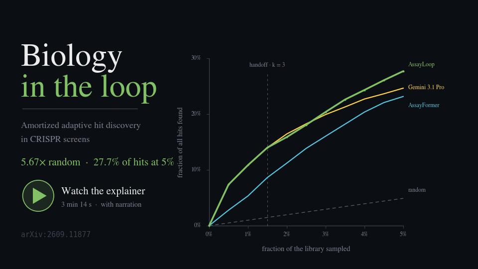

# AssayLoop

Code for **"Biology-in-the-loop: Amortized Adaptive Hit Discovery in CRISPR Screens."**

[:globe_with_meridians: Website](https://genentech.github.io/AssayLoop) | [:hugs: Checkpoints](https://huggingface.co/collections/Genentech/assaybench) | [:page_with_curl: Paper](https://arxiv.org/abs/2609.11877) | [](https://pypi.org/project/assaybench/)

[](https://genentech.github.io/AssayLoop/try.html)

## News

- **2026-09-26** — A 3-minute animated explainer video is available:
[](https://genentech.github.io/AssayLoop/explainer.html)

  Also as an [MP4](https://genentech.github.io/AssayLoop/assets/explainer/assayloop-explainer.mp4) .

---


A CRISPR screen has ~20,000 candidate genes and a budget for testing a few hundred at a
time. AssayLoop chooses which genes to test next, round after round, so hits show up early.
An LLM picks the first two or three rounds from its biological priors, then **AssayFormer**,
a transformer trained on 1,349 historical screens, takes over with those observations as its
context. On 20 held-out screens it recovers **27.7% of hits after assaying 5% of the
library**, ahead of every baseline we evaluated.

## Install

```bash
git clone https://github.com/Genentech/AssayLoop
cd assayloop
uv sync --extra torch     # drop --extra torch for the CPU-only baselines and analysis
```

## Quickstart

```bash
uv run assayloop run --model null --acq random --n-steps 10   # random baseline, 20 test screens
uv run assayloop info                                         # what resolved: provider, caches, paths
```

## AssayFormer

Load the released checkpoint and score it on a held-out screen:

```python
from huggingface_hub import snapshot_download
from assaybench import SequentialLoop, enrichment_factor
from assayloop.acquisitions.greedy_from_model import GreedyFromModel
from assayloop.models.amortized_ranker import AmortizedRankerModel
from assayloop.tasks import gene_universe, load_screens, make_task

ckpt = snapshot_download("Genentech/assayformer")
model = AmortizedRankerModel(checkpoint=ckpt, ckpt_file="model_last.pt")

screens = load_screens(target_set="paper_test")
universe = gene_universe(screens)          # the f2 pool the paper scores against
screen = screens[0]

task = make_task(screen, universe_genes=universe)
run = SequentialLoop(task, model, GreedyFromModel(),
                     metrics=[], batch_size=100).run(n_steps=10)

picked = [g for step in run.history for g in step.acquired_batch]
hits = [g for g, h in zip(screen.genes, screen.hits) if h]
print(enrichment_factor(picked, screen.genes, hits, universe, budget=1000))   # 7.61
```

No API key is needed to run AssayFormer or to reproduce its numbers.

Training your own:

```bash
uv run assayloop train-bpmf --target-set train --K 10               # gene-embedding init
uv run assayloop train-ranker                                       # supervised
uv run assayloop train-ranker-rl --init-checkpoint <ckpt-dir>       # + GRPO: EF 3.83 -> 4.83
uv run assayloop eval-ranker --checkpoint <ckpt-dir> --ckpt-file model_last.pt
```

## AssayLoop: the handoff

Collect the LLM warm start, then hand off to the ranker:

```bash
uv run assayloop run --model null --acq llm_single --screen-set paper_test --full-genome \
    --lm-config configs/lm/collect-gemini-3.1-pro.yaml

uv run assayloop eval-ranker-handoff \
    --checkpoint <rl-ckpt-dir> --ckpt-file model_last.pt \
    --warm-dir output/runs --warm-prefix sweep-<id>- --n 3
```
Open-vocabulary LLM acquisitions use the paper's shared f2 gene universe by default; pass
`--screen-library` only when you explicitly want per-screen filtering. The first `--n` rounds
are replayed from that sweep, then AssayFormer continues with them as context. For the llm
provider you set `ASSAYLOOP_LLM_PROVIDER` and that provider's key in `.env`.

## AssayFormer + DepMap

A fork addition, and this project's standard method: AssayFormer's ranking fused by
reciprocal rank with a **DepMap co-essentiality** kernel. Each round, the genes already
revealed as hits define a query direction in 808-dimensional dependency-profile space
(difference of means between revealed hits and non-hits); every candidate is scored by its
profile's agreement with that direction, and the two rankings are combined.

Held out on the benchmark folds it is worth **+0.307 adjusted EF per screen
[+0.222, +0.398]** over AssayFormer alone (348 screens, family bootstrap). The acquisition
is `codep_seed`; it makes no API calls.

### Prerequisites

Download DepMap `CRISPRGeneEffect.csv` (as `achilles.csv`) and `Model.csv` into one
directory, then:

```bash
# 1. cache the wide CSVs as .npz (minutes -> seconds on every later run)
python scripts/diagnostics/depmap_to_npz.py ~/depmap

# 2. build the ablated atlas. The default output is achilles_noeval2.npz (764 lines).
python scripts/diagnostics/build_noeval_atlas.py --depmap-dir ~/depmap

# 3. confirm no evaluation screen's own cell line survives in it (exits 1 if one does)
python scripts/diagnostics/audit_atlas_lines.py --depmap-dir ~/depmap \
    --atlas ~/depmap/achilles_noeval2.npz
```

An ablated atlas is `achilles.npz` with every Achilles cell line used by an evaluation
screen removed, so that "no screen's own cell line is in the atlas" holds **by
construction** rather than by audit. `achilles.npz` itself (all 808 lines) is superseded.

**There are two ablated atlases, and the difference matters for reading old results.**

| file | lines | status |
|---|---|---|
| `achilles_noeval.npz` | 768 | what **every recorded result in this repo used**. Drops the 40 lines a name match reaches. Four hTERT-RPE1 subclones (`RPE1-ss6/ss48/ss51/ss77`) survive it, and 61 evaluation screens use that line — so for 11% of the folds the by-construction claim does **not** hold. Rebuild it with `--legacy`. |
| `achilles_noeval2.npz` | **764** | the corrected default. Adds those four via the builder's `EXTRA_DROP`. Audits clean. **Use this for new campaigns.** |

The gap was a name-matching failure, not a build failure: the drop set is keyed on
`cell_line` strings, and `norm("hTERT-RPE1")` shares no form with `norm("RPE1-ss48")`.
Step 3 is the check that catches this class of problem; run it after any atlas rebuild.

**It changes no result.** Re-running AF + DepMap on all 61 affected screens against the
corrected atlas moves the paired delta by **-0.0012** on the `validation` fold and
**-0.0070** on `test` — against a reported +0.307 [+0.222, +0.398] per screen, about 2% of
the effect and far inside the interval. Per screen the median change is exactly **0.0**,
43 of 61 are unchanged in hits, and the direction is 18 worse / 21 better. The recorded
numbers stand as reported; they need the exception stated rather than the blanket claim.

**Do not mix the two in one table**, and do not overwrite `achilles_noeval.npz` — every
stored `result.json` names it, and replacing it in place would make their provenance wrong.
The scripts under `scripts/external/` still default to the 768-line file so their recorded
outputs stay reproducible; pass `--atlas ~/depmap/achilles_noeval2.npz` for new work.

### Running it

```bash
CKPT=<assayformer-ckpt-dir>        # the HF snapshot holding model_last.pt and vocab.json

uv run assayloop run --model amortized_ranker --acq codep_seed \
    --screen-set paper_test --n-steps 10 --batch-size 100 \
    --full-genome --min-screen-freq 2 \
    --model-param checkpoint=$CKPT --model-param ckpt_file=model_last.pt \
    --model-param device=cuda \
    --acq-param profile_npz=~/depmap/achilles_noeval2.npz \
    --acq-param weight=0.5 --acq-param knn_weight=0.0 \
    --acq-param query=diffmeans --acq-param fuse=rrf \
    --sweep-id my-codep-run --tag my-codep-run
```

| `--acq-param` | Default | What |
|---|---|---|
| `profile_npz` | *required* | the atlas; required even at `weight=0`, where it is loaded and contributes nothing |
| `weight` | `1.0` | DepMap kernel weight. **0.5 is the deployed value**; it peaks there in both directions |
| `knn_weight` | `0.0` | a second, screen-kNN term. Unresolved and negative on three of four sets — leave off |
| `query` | `diffmeans` | `diffmeans` subtracts the non-hit mean; `centroid` uses hits only and is weaker |
| `fuse` | `rrf` | `rrf` is scale-free rank fusion; `zsum` standardises instead |
| `min_seeds` | `2` | revealed hits needed before the kernel engages. Optimal in both directions |

**The baseline is nested.** `--acq-param weight=0.0` reproduces plain AssayFormer pick for
pick (`tests/test_codep_seed.py` pins this), so run it as the paired control rather than
`--acq greedy` and every other code path stays identical:

```bash
# ... same command, only this line changes
    --acq-param weight=0.0 --acq-param knn_weight=0.0 \
```

### The candidate pool matters, and is not a free choice

`--full-genome --min-screen-freq 2` acquires from the **f2 universe**: the union of the
screen set's libraries, keeping genes measured in at least two. Picks landing outside the
screen being scored are *forgiven* — they consume a slot but do not count against EF, so
the effective budget is `1000 - forgiven`, not 1000.

That convention exists for **open-vocabulary LLM policies**, which name genes a given
library never measured. `codep_seed` is a closed-vocabulary ranker over a supplied
candidate list, so it needs no such protection, and the forgiveness inflates its absolute
EF unevenly across sets (mean effective budget 915 on `paper_test`, 823 on the
`validation` fold, **309** on the `test` fold).

| you want to… | pool | flag |
|---|---|---|
| report absolute performance | the screen's own library | omit `--full-genome` (the default), or `--screen-library` |
| compare against the paper's table | the shared f2 universe | `--full-genome --min-screen-freq 2` |
| compare against an LLM arm | whatever that arm used | must match, since LLM arms require the shared pool |

The paired AF vs AF + DepMap delta is robust to the choice (+0.229 library pool, +0.249
shared f2, same 348 screens) because both arms absorb identical forgiveness. Absolute EF
is not. **Never put numbers from two different pools in one table.**

### Scoring a run

```bash
# paired delta against the nested weight-0 baseline, family bootstrap
python scripts/diagnostics/codep_gated.py --screen-set validation \
    --off <baseline-sweep-id> --on <codep-sweep-id> \
    --dir output/runs --exclude-set paper_validation --quiet
```

`output/runs` is sorted into one folder per method tested, so a family's baseline and its
treatment arm live in different directories (`af_alone_baseline/` and `af_depmap/`). The
scorers resolve a sweep id to whichever folder holds it via
`scripts/diagnostics/run_paths.py`, so passing the root is correct.
`output/runs/README.md` indexes every folder. Note `--resume` does **not** search: move a
sweep back up to `output/runs/` before resuming it.

### Screens outside AssayBench

`scripts/external/run_external.py` runs both arms over externally built `ScreenRecord`s
(seven published papers are set up this way; see `scripts/external/SOURCES.md` for each
source file, sheet and hit-call column, plus rebuild commands):

```bash
python scripts/external/run_external.py --screens <pickle> \
    --atlas ~/depmap/achilles_noeval2.npz --tag mypaper \
    --out output/runs/external/mypaper_results.json
```

`--atlas` is passed explicitly here because the script's own default is still the 768-line
`achilles_noeval.npz`, which is what its recorded results used.

It defaults to the screen's own library as the pool, so every pick is measured and the
effective budget is exactly 1000. Pass `--universe <genes.json>` for a fixed cross-screen
pool instead. A screen outside AssayBench cannot share a cell line with an evaluation
screen by definition, so the atlas ablation is not what protects it — the leakage argument
there is that the paper postdates every fold, which `scripts/external/SOURCES.md` records
per dataset.

## Screen sets

```python
from assayloop.tasks import load_screens

load_screens(target_set="paper_test")          # the paper's curated 20-screen test set
load_screens(target_set="test")                # the full 334-screen test fold
load_screens(dataset_names=["U_1733_merged"])  # exact screens
```

| `--screen-set` | What |
|---|---|
| `paper_test` (default) | the curated **20-screen test set** the paper reports |
| `paper_validation` | the curated 20-screen validation set (checkpoint selection) |
| `train` | the full 1,349-screen training fold |
| `validation` | the full 218-screen validation fold |
| `test` | the full 334-screen test fold |
| `lopo-*-{train,test}` | the leave-one-phenotype-out splits |
| `/path/to.yaml` | your own list |

The former `public`, `public_validation`, `public_train`, `public_val`, and
`public_test` names remain accepted as compatibility aliases for released
checkpoints and older commands.

```bash
# Same random baseline as the Quickstart, on the validation set instead of the test set.
uv run assayloop run --model null --acq random --screen-set paper_validation
```

## Metrics

Every metric takes the genes a method picked and the screen's ground truth. Two of them also
take the candidate pool, which is how a pick that is a real gene but not in this screen's
library gets charged:

```python
import numpy as np
from assaybench import (adjusted_nauc, enrichment_factor, fraction_of_hits,
                        percent_essential, shortfall)
from assayloop.tasks import gene_universe, load_screens

screens = load_screens(target_set="paper_test")
universe = gene_universe(screens)             # the f2 pool, 21,147 genes
screen = screens[0]
hits = [g for g, h in zip(screen.genes, screen.hits) if h]

picked = list(np.random.default_rng(0).choice(universe, 1000, replace=False))
rounds = [picked[i * 100:(i + 1) * 100] for i in range(10)]   # your method's ten batches

enrichment_factor(picked, screen.genes, hits, universe, budget=1000)  # EF    0.993
adjusted_nauc(rounds, screen.genes, hits, universe)                   # nAUC  0.015
fraction_of_hits(picked, screen.genes, hits)                          # FH    0.047
shortfall(picked, screen.genes)                                       # SF    0.124
percent_essential(picked, screen.genes, hits)                         # %ess  0.250
```

## Your own method

Implement `Model` (score the candidates) or `AcquisitionFunction` (choose from the scores)
and hand it to the same loop:

```python
from assaybench import Model, ModelPrediction, SequentialLoop
from assayloop.acquisitions.greedy_from_model import GreedyFromModel
from assayloop.tasks import gene_universe, load_screens, make_task

class MyRanker(Model):
    """Score a gene 1.0 if a hit found so far shares its first three letters.

    Gene symbols are loosely paralogous by prefix -- NDUFA1/NDUFA2, RPL3/RPL4 --
    so this is a crude "more of whatever is working". It is here to show the
    interface, not because it is a good policy.
    """

    def predict(self, observations, candidates, task_context=None):
        # observations is what has been assayed so far. o.candidate is the gene
        # symbol; o.label is {"hit": bool, "relevance_score": float}. candidates
        # is what is left to score.
        hit_prefixes = {o.candidate[:3] for o in observations if o.label["hit"]}
        return ModelPrediction(
            scores={g: float(g[:3] in hit_prefixes) for g in candidates})

screens = load_screens(target_set="paper_test")
task = make_task(screens[0], universe_genes=gene_universe(screens))   # the f2 pool
run = SequentialLoop(task, MyRanker(), GreedyFromModel(),
                     metrics=[], batch_size=100).run(n_steps=10)

for step in run.history:            # one record per round
    found = sum(1 for o in step.new_observations if o.label["hit"])
    print(f"round {step.step}: assayed {len(step.acquired_batch)}, {found} hits")
```

To reach your method from the CLI, add a branch to `make_model` in
`src/assayloop/experiment/runner.py`. The five abstractions (`Task`, `Model`,
`AcquisitionFunction`, `Metric`, `SequentialLoop`) live in `assaybench`, so
`pip install assaybench` is enough to benchmark a policy without this repo.

## Downloads

| Command | Size | Needed for |
|---|---|---|
| `bash scripts/fetch_sweeps.sh` | 35 MB | the published LLM/external-baseline runs and full call logs needed for exact raw-response replay |
| `bash scripts/fetch_presage_cache.sh` | 3.4 GB | `knn`, `rf`, `biobo`, `llmnn`, Vendi diversity |
| `bash scripts/fetch_gene_sets.sh` | MSigDB | `bio_ucb`, pathway metrics, the sunburst figure |
| `bash scripts/fetch_ground_truth.sh` | STRING / CORUM / SIGNOR | network-recovery analysis |

The interactive UMAP includes DepMap Public 26Q1 common-essential annotations.
They are not covered by this repository's MIT License; see the
[third-party notices](THIRD_PARTY_NOTICES.md) and the reproduced
[DepMap terms](LICENSES/DEPMAP_TERMS.md).

## Reproducing the paper's table

```bash
bash scripts/fetch_sweeps.sh
uv run assayloop figure main-table --min-screen-freq 2
uv run assayloop figure --list             # every paper figure, and what has to exist first
```

[`README_DETAILED.md`](README_DETAILED.md) has the per-row commands, every baseline and acquisition, and the figure scripts.

## Citation

If you use this code, please cite the AssayLoop paper:

```bibtex
@article{edwards2026biologyloop,
  title={Biology-in-the-loop: Amortized Adaptive Hit Discovery in CRISPR Screens},
  author={Edwards, Carl and De Brouwer, Edward and Li, Xiner and Lee, Namkyeong and
          Hajiramezanali, Ehsan and Biton, Anne and Mostafavi, Sara and Scalia, Gabriele},
  journal={arXiv preprint arXiv:2609.11877},
  url={https://arxiv.org/abs/2609.11877},
  year={2026}
}
```
